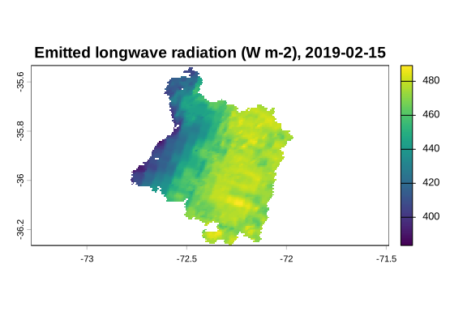

<!-- README.md is generated from README.Rmd. Please edit that file -->
<h1 align="center">
<picture>
<source media="(prefers-color-scheme: dark)" srcset="man/figures/logo-horizontal-dark.svg">

</picture>
</h1>
<!-- badges: start -->

[](https://github.com/djwillichile/EarthFlux/releases/latest)
[](https://github.com/djwillichile/EarthFlux/blob/main/DESCRIPTION)
[](https://github.com/djwillichile/EarthFlux/actions/workflows/R-CMD-check.yaml)
[](https://opensource.org/licenses/MIT)
[](https://lifecycle.r-lib.org/articles/stages.html#experimental)
<!-- badges: end -->

### Land-Surface Energy and Water Fluxes from Earth Observation Data

**MODIS + METRIC + GWR → ETa**

EarthFlux is an R package for modelling land-surface energy and water
fluxes from Earth observation data. Its first target is spatially
distributed actual evapotranspiration (ETa) estimated with the METRIC
(Mapping EvapoTranspiration at high Resolution with Internalized
Calibration) surface energy balance framework.

Its methodological focus is the **meteorological forcing** of METRIC.
Instead of relying only on a single weather station assumed to be
representative of the whole scene, EarthFlux represents weather
variables as spatial surfaces, for example with geographically weighted
regression (GWR), so that this choice can be compared against simpler
alternatives.

``` text
MODIS surface state  +  weather stations
                              │
                 spatial forcing (GWR or alternatives)
                              │
     METRIC: Rn → G → anchor pixels → rah, dT → H → LE
                              │
                  ETinst → ETrF → ETa  (+ diagnostics)
```

Whether spatial forcing improves ETa estimates is a **research
question** that EarthFlux is designed to test. It is not a claim made by
this package.

## Status

EarthFlux 0.1.0 is the **first, experimental release**. It is **not on
CRAN** and it is **not for operational or scientific production use**:
no result has been validated.

What 0.1.0 includes:

- **METRIC core physics** as numeric functions, from net radiation
  (`ef_net_radiation()` and its radiation components) through soil heat
  flux (`ef_g()`), anchor pixel selection (`ef_select_anchors()`), the
  iterative calibration of the sensible heat flux (`ef_calibrate_h()`)
  and the latent heat flux, to daily actual evapotranspiration
  (`ef_et_daily()`).
- **Meteorological forcing**: weather station tables and their quality
  control (`ef_station_table()`, `ef_station_qc()`), derived variables
  and reference evapotranspiration (`ef_ref_et()`,
  `ef_station_ref_et()`; grass ETo of FAO-56 and grass or alfalfa
  reference of the ASCE-EWRI standardized equation).
- **Spatial regionalization** of station variables over the working grid
  (`ef_regionalize()`): representative station (C1), global regression
  and inverse distance weighting (C2) and geographically weighted
  regression (C3, internal GWR core), with exact prediction by raster
  blocks, optionally in parallel, and spatial block cross-validation.
- **MODIS preprocessing** (internal, not exported yet) into the surface
  state of the METRIC chain, and the example scene `cauquenes_modis`
  (Cauquenes province, Chile, 15 February 2019).

What 0.1.0 does **not** include: the integrated `earthflux()` workflow
and its presets, the automatic download of MODIS products, the elevation
model and gridded weather forcing, and any validation results.

Verification status:

- **Verified** against the primary sources: the reference
  evapotranspiration chain of FAO-56 (worked examples reproduced) and of
  ASCE-EWRI (2005) (equations and constants; its worked examples are not
  reproduced yet), the unit conversions and the MODIS product facts
  (scale factors, fill values, quality bits, with citations to the
  official user guides).
- **Verified against the SEBAL Idaho manual** of the METRIC authors
  (Waters et al., 2002), the direct predecessor of METRIC, with page and
  equation: most METRIC formulations, from net radiation to daily ET,
  including the stable momentum correction of the blending height
  (decision SH-11, default 2 m). The cross-check with Allen, Tasumi &
  Trezza (2007) remains desirable.
- **Candidate** (not covered by that manual): among others the
  partitioned shortwave transmissivity and its terrain projection, the
  soil heat flux of Tasumi and the anchor selection criteria. Open
  points include the temperature used for the incoming longwave
  radiation and the emissivity of non-vegetated pixels, derived from a
  LAI assigned by the user (option `lai_nonveg`; LAI 0 in the example
  scene).

## Design principles

- **Sensor-independent physics.** METRIC functions take physical
  variables with documented units; sensor modules (MODIS first) produce
  them.
- **Independent spatial forcing.** GWR is a separate module whose fitted
  models, bandwidths, residuals and diagnostics remain inspectable.
- **Modular METRIC.** Net radiation, soil heat flux, anchor pixel
  selection, aerodynamic resistance, dT, sensible and latent heat flux
  and ET are separate, individually tested components.
- **Diagnostics instead of silent corrections.** Physically anomalous
  values are reported and flagged, never silently modified.
- **Scalable.** Raster processing is based on
  [terra](https://CRAN.R-project.org/package=terra), with optional
  parallel processing (under the user’s `future` plan) that gives
  identical results to sequential runs.

## Installation

You can install the latest release of EarthFlux from GitHub with:

``` r
# install.packages("pak")
pak::pak("djwillichile/EarthFlux@*release")
```

or the development version with `pak::pak("djwillichile/EarthFlux")`.

## Example

The packaged scene `cauquenes_modis` is the MODIS surface state of the
Cauquenes province (Maule Region, Chile) on 15 February 2019 (Terra
overpass), on the 1 km sinusoidal grid. It is a packed `terra` raster:

``` r
library(EarthFlux)

r <- terra::unwrap(cauquenes_modis)
data.frame(layer = names(r), unit = terra::units(r))[1:9, ]
#>        layer   unit
#> 1        lst      K
#> 2     albedo      -
#> 3       ndvi      -
#> 4        lai m2 m-2
#> 5 emissivity      -
#> 6    emis_31      -
#> 7    emis_32      -
#> 8        doy      -
#> 9   utc_hour      h
```

The longwave radiation emitted by the surface follows from the land
surface temperature (K) and the broadband emissivity of every cell (`NA`
outside the province and where the LST is missing):

``` r
rl_out <- terra::rast(r[["lst"]])
terra::values(rl_out) <- ef_rl_out(
  lst = terra::values(r[["lst"]], mat = FALSE),
  emissivity = terra::values(r[["emissivity"]], mat = FALSE)
)
names(rl_out) <- "rl_out"
terra::global(rl_out, c("min", "mean", "max"), na.rm = TRUE)
#>             min     mean      max
#> rl_out 383.4013 458.0683 489.6118

# Computed on the native grid; shown in geographic coordinates (EPSG:4326)
rl_out_lonlat <- terra::project(rl_out, "EPSG:4326", method = "bilinear")
terra::plot(rl_out_lonlat,
            main = "Emitted longwave radiation (W m-2), 2019-02-15")
```



The map is projected to geographic coordinates (WGS 84, EPSG:4326) for
display only; the scene and every computation stay on the native MODIS
grid.

The article [Example scene:
Cauquenes](https://djwillichile.github.io/EarthFlux/articles/cauquenes-example.html)
on the package website shows every layer, the flag words and the
provenance of the scene.

Net radiation for two pixels, with illustrative input values (not
observations). `rl_out` is the longwave radiation emitted by the surface
and `emissivity` must be the emissivity used to compute it; a scalar
`rl_in` is recycled.

``` r
ef_net_radiation(
  rs_in = c(800, 650),        # incoming shortwave [W m-2]
  albedo = c(0.20, 0.25),     # broadband albedo [-]
  rl_in = 320,                # incoming longwave [W m-2]
  rl_out = c(450.08, 430.50), # emitted longwave [W m-2]
  emissivity = c(0.98, 0.97)  # broadband emissivity [-]
)
#> [1] 503.52 367.40
```

Invalid inputs are rejected with classed errors instead of being
silently corrected:

``` r
ef_net_radiation(rs_in = 800, albedo = 1.2, rl_in = 320, rl_out = 450, emissivity = 0.98)
#> Error in `ef_net_radiation()`:
#> ! `albedo` must lie in [0, 1]; found 1 value(s) outside this interval.
```

## Related work

EarthFlux is conceptually inspired by the R package
[water](https://github.com/midraed/water) (Olmedo et al., 2016), which
implements METRIC for Landsat imagery. EarthFlux is an independent
implementation with a different scope: sensor-independent physics,
spatially varying meteorological forcing and diagnostics as part of the
results.

## Citation

Citation information is available with `citation("EarthFlux")`.

## License

MIT © Guillermo S. Fuentes-Jaque
