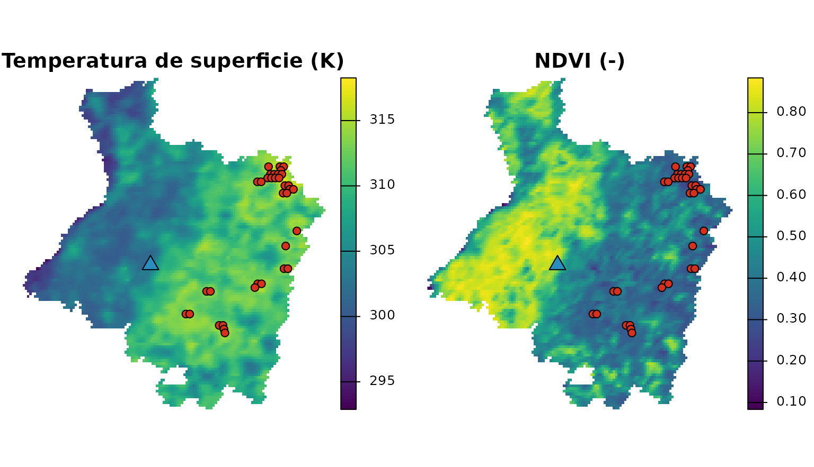
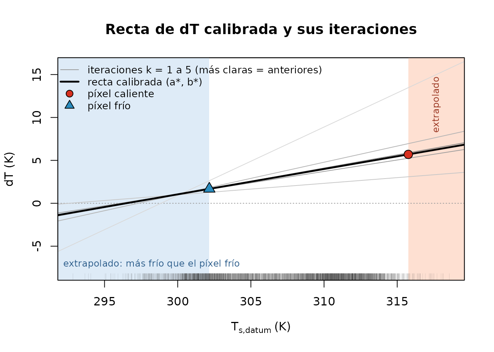
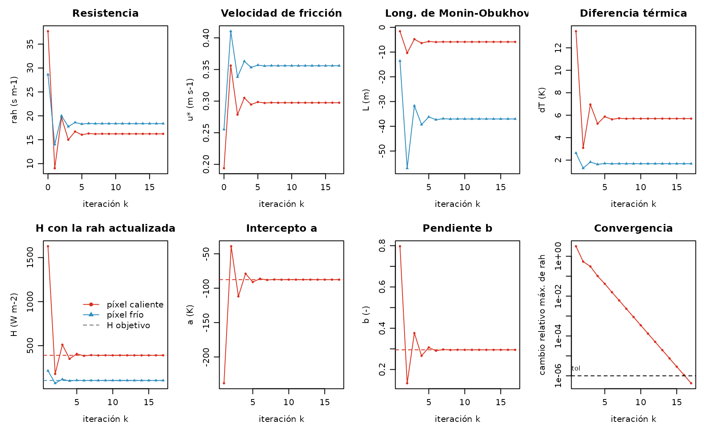
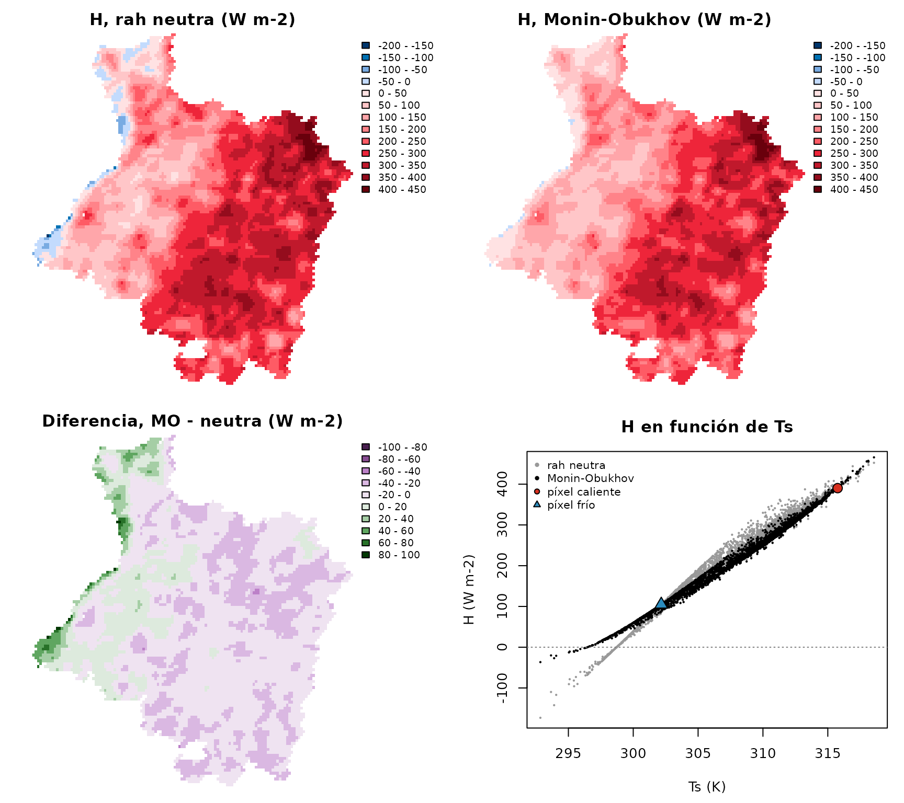
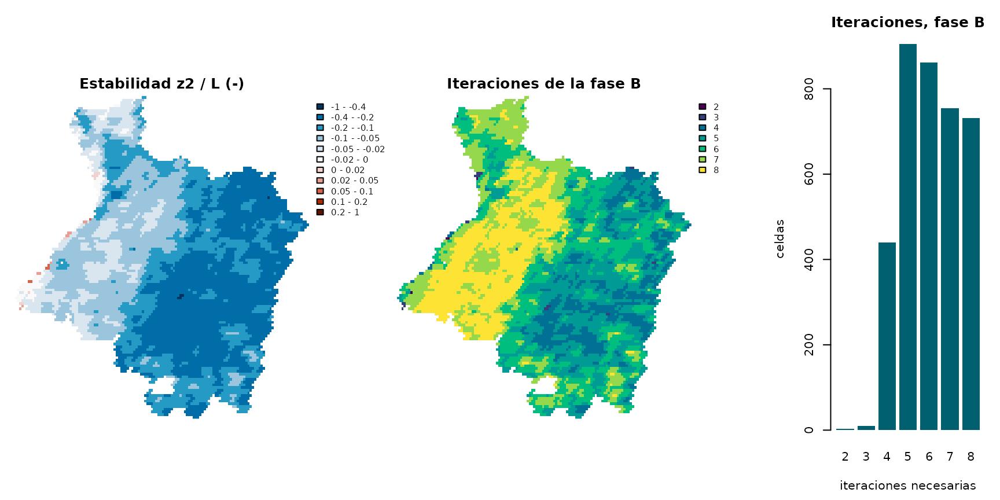

# Píxeles ancla y la iteración de Monin–Obukhov (español)

> **Versión en español** del artículo [Hot and cold anchors and the
> Monin–Obukhov
> iteration](https://djwillichile.github.io/EarthFlux/articles/anchors-monin-obukhov.md),
> pensada para la docencia. El código, los datos, las figuras y la
> verificación son los mismos; se tradujeron el texto, los comentarios
> del código y las etiquetas de las figuras. Las tablas que imprime R
> conservan los nombres en inglés del paquete.

El flujo de calor sensible $`H`$ es el término más difícil de un balance
de energía METRIC. Este artículo explica, paso a paso, cómo lo estima
METRIC (Allen et al., 2007): la calibración interna con un píxel ancla
caliente y uno frío, y la iteración de Monin–Obukhov que corrige la
resistencia aerodinámica por la estabilidad atmosférica. Cada ecuación
se ejecuta sobre la escena MODIS de la provincia de Cauquenes incluida
en el paquete (14 de febrero de 2019; véase el artículo [Example scene:
Cauquenes](https://djwillichile.github.io/EarthFlux/articles/cauquenes-example.md),
en inglés) con las funciones exportadas de EarthFlux, y la iteración se
escribe a mano y se contrasta con
[`ef_calibrate_h()`](https://djwillichile.github.io/EarthFlux/reference/ef_calibrate_h.md).

Los números de ecuación y de página se refieren al manual SEBAL de Idaho
de los autores de METRIC (Waters et al., 2002), contra el cual se
verifican las formulaciones de EarthFlux.

> **Experimental e ilustrativo.** EarthFlux es un paquete experimental y
> sus resultados no están validados. La escena no incluye datos
> meteorológicos ni modelo de elevación, por lo que este artículo usa
> una estación meteorológica horaria **ilustrativa** y una **elevación
> uniforme ilustrativa** (ambas inventadas para este artículo, aunque
> plausibles para el lugar y la fecha). Los números que siguen muestran
> cómo funciona el método; no son estimaciones de los flujos de
> Cauquenes.

Todo lo que sigue se ejecuta sin conexión a internet, a partir del
paquete instalado.

## 1. Por qué H es difícil

En el momento del paso del satélite, el flujo de calor latente $`LE`$ es
el residuo del balance de energía en la superficie (Waters et al., 2002,
ec. 1):

``` math
LE = R_n - G - H ,
```

con la radiación neta $`R_n`$, el flujo de calor del suelo $`G`$ y el
flujo de calor sensible $`H`$, todos en W m⁻². $`R_n`$ y $`G`$ se
obtienen, con una incertidumbre conocida, del estado de la superficie
(albedo, temperatura de superficie, emisividad, índices de vegetación) y
de la geometría solar. $`H`$ es transportado por la turbulencia y se
escribe como una ecuación de transferencia aerodinámica (*bulk
transfer*) (Waters et al., 2002, p. 25, ec. 25):

``` math
H = \frac{\rho_{air}\, c_p\, dT}{r_{ah}} ,
```

donde $`\rho_{air}`$ es la densidad del aire (kg m⁻³), $`c_p = 1004`$ J
kg⁻¹ K⁻¹ el calor específico del aire, $`r_{ah}`$ la resistencia
aerodinámica al transporte de calor (s m⁻¹) entre dos alturas sobre el
plano de desplazamiento cero, $`z_1 = 0.1`$ m y $`z_2 = 2`$ m, y
$`dT = T_{z_1} - T_{z_2}`$ la diferencia de temperatura del aire entre
esas dos alturas (K).

El atajo obvio, $`dT \approx T_s - T_{air}`$, con la temperatura de
superficie terrestre $`T_s`$ del satélite y la temperatura del aire de
una estación meteorológica, no funciona, por tres razones:

- **La temperatura radiométrica no es la temperatura aerodinámica.** El
  satélite ve una temperatura radiométrica: una mezcla de suelo y hojas
  al sol y a la sombra, ponderada por el ángulo de observación y la
  emisividad. La temperatura que impulsa la transferencia de calor es
  una temperatura aerodinámica en la fuente aparente de calor, dentro
  del dosel. Ambas pueden diferir en varios kelvin, y la diferencia
  depende de la cobertura, que es justamente lo que varía dentro de una
  escena.
- **Los errores de $`T_s`$ son del tamaño de $`dT`$.** $`dT`$ es de
  apenas unos pocos kelvin. Un error de 1–2 K en $`T_s`$ (corrección
  atmosférica, emisividad, ángulo de observación) es un error de decenas
  de por ciento en $`H`$.
- **No hay temperatura del aire por píxel.** Las estaciones son pocas, e
  incluso una red densa entrega la temperatura del aire sobre un pasto
  de referencia, no sobre cada predio.

La sensibilidad de $`H`$ a $`dT`$ se lee en el factor
$`\rho_{air} c_p / r_{ah}`$ (W m⁻² K⁻¹): con una densidad del aire
cercana a 1,15 kg m⁻³ y resistencias de 10–50 s m⁻¹, cada kelvin de
$`dT`$ vale decenas de W m⁻² de $`H`$ (el valor en el píxel frío de la
escena se calcula en la sección 2).

## 2. Calibración interna con dos píxeles ancla

### La idea

METRIC, siguiendo a SEBAL (Bastiaanssen et al., 1998), nunca mide
$`dT`$. Supone que, dentro de una escena, $`dT`$ es una función lineal
de la temperatura de superficie (Waters et al., 2002, p. 30, ec. 32):

``` math
dT = a + b\, T_{s,datum} ,
```

y encuentra $`a`$ y $`b`$ a partir de dos píxeles cuyo $`H`$ se conoce
por su balance de energía: los **píxeles ancla**. Las superficies
calientes calientan más el aire que tienen encima, de modo que
$`b > 0`$. $`T_{s,datum}`$ es la temperatura de superficie referida a
una elevación común (el *datum*),
$`T_{s,datum} = T_s + \Gamma\,(z - z_{datum})`$, con un gradiente
térmico vertical $`\Gamma`$ (Waters et al., 2002, apéndice 12, ec.
12-7); en este artículo la elevación es uniforme y $`\Gamma = 0`$, de
modo que $`T_{s,datum} = T_s`$. (El manual escribe $`dT = b + a\,T_s`$,
con $`a`$ la pendiente; EarthFlux llama $`a`$ al intercepto y $`b`$ a la
pendiente.)

Como $`a`$ y $`b`$ se ajustan dentro de la imagen, los errores
sistemáticos de $`T_s`$ (un sesgo de la corrección atmosférica, por
ejemplo) se absorben en gran parte: $`dT`$ depende de diferencias de
$`T_s`$, no de su valor absoluto. Esto es lo que significa la
«calibración internalizada» (*internalized calibration*) del nombre de
METRIC.

Los dos píxeles ancla (Waters et al., 2002, pp. 30–31, pasos 5a y 5b)
son:

- el **píxel frío**: vegetación agrícola bien regada, con cobertura
  completa del suelo, que evapora 1,05 veces la tasa de la referencia de
  alfalfa ($`ET_rF = 1.05`$), de modo que
  ``` math
  LE_{cold} = 1.05\, \lambda\, ET_{r,inst}, \qquad
  H_{cold} = R_{n,cold} - G_{cold} - LE_{cold} ,
  ```
  con el calor latente de vaporización $`\lambda`$ y la
  evapotranspiración de referencia instantánea de alfalfa
  $`ET_{r,inst}`$ expresada como flujo de masa;
- el **píxel caliente**: un predio agrícola seco y desnudo, donde la
  evaporación es nula ($`ET_rF = 0`$), de modo que toda la energía
  disponible va a $`H`$:
  ``` math
  H_{hot} = R_{n,hot} - G_{hot} .
  ```

Para cada píxel ancla se invierte la ecuación de transferencia para
obtener el $`dT`$ que produce su $`H`$ (Waters et al., 2002, p. 30, ec.
33):

``` math
dT_i = \frac{H_i\, r_{ah,i}}{\rho_{air,i}\, c_p}, \qquad i \in \{hot,\ cold\},
```

y los dos puntos $`(T_{s,datum,i},\ dT_i)`$ fijan la recta:

``` math
b = \frac{dT_{hot} - dT_{cold}}{T_{s,datum,hot} - T_{s,datum,cold}},
\qquad a = dT_{cold} - b\, T_{s,datum,cold} .
```

El problema es que $`r_{ah,i}`$ depende de la estabilidad del aire, que
a su vez depende del propio $`H`$. Ese es el tema de la sección 3.
Primero, los datos de entrada.

### La escena y una estación meteorológica ilustrativa

El estado de la superficie es la escena incluida en el paquete, en su
grilla sinusoidal nativa de 1 km. El núcleo numérico de EarthFlux
trabaja con matrices simples, así que las capas se leen como matrices
(una fila de la grilla por cada fila de la matriz):

``` r

library(EarthFlux)

r <- terra::unwrap(cauquenes_modis)
as_mat <- function(name) terra::as.matrix(r[[name]], wide = TRUE)

lst <- as_mat("lst")               # K
albedo <- as_mat("albedo")         # -
ndvi <- as_mat("ndvi")             # -
lai <- as_mat("lai")               # m2 m-2
emissivity <- as_mat("emissivity") # -
utc_hour <- as_mat("utc_hour")     # h, hora de paso de cada celda
doy <- as_mat("doy")
inside <- !is.na(as_mat("flags_lst")) # celdas de la provincia

# Longitud y latitud de los centros de las celdas (grados)
lonlat <- terra::project(terra::xyFromCell(r, seq_len(terra::ncell(r))),
                         from = terra::crs(r), to = "EPSG:4326")
lon <- matrix(lonlat[, 1], terra::nrow(r), byrow = TRUE)
lat <- matrix(lonlat[, 2], terra::nrow(r), byrow = TRUE)
summary(as.vector(utc_hour))
#>    Min. 1st Qu.  Median    Mean 3rd Qu.    Max.     NAs 
#>   15.02   15.03   15.04   15.06   15.11   15.12    5885
```

El paso del satélite ocurre cerca de las 15:02 UTC (10:12 hora solar
media local); todas las celdas de la provincia fueron observadas en la
misma pasada de Terra, entre las 15:01 y las 15:07 UTC, a 12–18 grados
del nadir.

La escena no tiene modelo de elevación. **Solo para este artículo**, la
elevación se fija en 150 m uniformes, aproximadamente la elevación de la
ciudad de Cauquenes. Esta es la situación del preset `"idaho2002_flat"`:
sin gradiente térmico vertical ($`\Gamma = 0`$) y una sola
transmisividad de onda corta para toda la escena.

``` r

z_scene <- 150 # m, ilustrativa, uniforme
elevation <- ifelse(inside, z_scene, NA)
pressure <- ef_air_pressure(elevation) # kPa
```

Los datos meteorológicos provienen de una estación horaria
**ilustrativa** (valores inventados para este artículo, coherentes con
una mañana despejada de verano en el interior de la provincia; no son
observaciones): temperatura del aire, punto de rocío, velocidad del
viento a 2 m sobre pasto y radiación solar para las cuatro horas en
torno al paso del satélite. A partir de ellos se calcula la
evapotranspiración de referencia horaria de alfalfa $`ET_r`$ con la
ecuación estandarizada de ASCE (ASCE-EWRI, 2005):

``` r

station <- list(lon = -72.35, lat = -35.97, elevation = z_scene)
wx <- data.frame(
  utc_start = 13:16,                       # hora 13:00-14:00 UTC, ...
  air_temperature = c(19.0, 21.5, 24.0, 26.0), # grados C
  dewpoint = c(10.0, 10.0, 10.2, 10.2),        # grados C
  wind_2m = c(1.8, 2.2, 2.6, 3.0),             # m s-1
  solar_radiation = c(2.10, 2.62, 2.98, 3.18)  # MJ m-2 h-1
)
wx$utc_mid <- wx$utc_start + 0.5

deg <- pi / 180
ra <- ef_ra_period(lat = station$lat * deg, lon = station$lon * deg,
                   doy = 45, utc_mid = wx$utc_mid, period_hours = 1,
                   standard = "asce")
ea <- ef_ea_dewpoint(wx$dewpoint)
rn_ref <- ef_ref_net_radiation(
  solar_radiation = wx$solar_radiation,
  clear_sky_radiation = ef_rso(ra, station$elevation),
  vapour_pressure = ea, air_temperature = wx$air_temperature,
  timestep = "hourly", standard = "asce"
)$rn
daytime <- rn_ref > 0
g_ref <- ef_ref_soil_heat_flux(rn_ref, reference = "alfalfa",
                               timestep = "hourly", standard = "asce",
                               daytime = daytime)
wx$etr <- ef_ref_et(
  net_radiation = rn_ref, soil_heat_flux = g_ref,
  air_temperature = wx$air_temperature, wind_speed_2m = wx$wind_2m,
  vapour_pressure_deficit = ef_es(wx$air_temperature) - ea,
  slope = ef_es_slope(wx$air_temperature),
  psychrometric = ef_psychrometric(ef_air_pressure(station$elevation)),
  reference = "alfalfa", timestep = "hourly", standard = "asce",
  daytime = daytime
)$et_ref
wx
#>   utc_start air_temperature dewpoint wind_2m solar_radiation utc_mid       etr
#> 1        13            19.0     10.0     1.8            2.10    13.5 0.4283063
#> 2        14            21.5     10.0     2.2            2.62    14.5 0.5857801
#> 3        15            24.0     10.2     2.6            2.98    15.5 0.7257824
#> 4        16            26.0     10.2     3.0            3.18    16.5 0.8347101
```

Como en los presets de
[`earthflux()`](https://djwillichile.github.io/EarthFlux/reference/earthflux.md),
cada celda toma los valores a su propia hora de paso, por interpolación
lineal entre los puntos medios de las horas:

``` r

at_overpass <- function(v) {
  out <- utc_hour
  out[] <- stats::approx(wx$utc_mid, v, xout = as.vector(utc_hour))$y
  out
}
etr_inst <- at_overpass(wx$etr)    # mm h-1, referencia de alfalfa
wind_2m <- at_overpass(wx$wind_2m) # m s-1
```

### Radiación, flujo de calor del suelo y rugosidad

Las opciones son las del preset `"idaho2002_flat"` (véase
`ef_preset("idaho2002_flat")`), salvo que los datos meteorológicos
provienen de la estación ilustrativa anterior y no de un forzante
regionalizado.

``` r

preset <- ef_preset("idaho2002_flat")
```

La rugosidad para el momentum se obtiene del LAI,
$`z_{om} = 0.018\, LAI`$ (Waters et al., 2002, p. 27, ec. 31a), con el
mínimo de 0,005 m del preset, y la velocidad del viento a la altura de
mezcla $`z_b = 200`$ m se extrapola desde la estación con un perfil
logarítmico sobre su pasto (Waters et al., 2002, p. 26, ecs. 27 y 29):

``` r

zom <- pmax(ef_zom(lai = lai, method = "lai")$zom, preset$roughness$zom_min)
w <- preset$wind
u_blend <- ef_blending_wind(wind_2m, height = w$height,
                            zom_station = w$zom_station,
                            d_station = w$d_station,
                            blending_height = w$blending_height)
range(u_blend, na.rm = TRUE) # m s-1 a 200 m
#> [1] 4.654201 4.733223
```

Los píxeles ancla se seleccionan antes de la radiación neta, porque la
radiación de onda larga incidente de los presets usa la temperatura de
superficie del píxel frío (Waters et al., 2002, p. 23, ec. 23). Los
candidatos deben pasar el control de calidad estricto de los presets:
ningún flag `warning` o `critical` (bits 6–14, y el bit 16,
`EF_SURF_VIEW_ANGLE_HIGH`: una LST observada a más de 40 grados del
nadir; ninguna en esta escena) y ningún LAI asignado (bit 15,
`EF_SURF_LAI_ASSIGNED`) en las palabras de flags de las variables de
superficie, todas las subceldas de 500 m de los insumos agregados
válidas y todos los insumos definidos.

``` r

geo <- ef_solar_geometry(doy = doy, utc_hour = utc_hour, lat = lat * deg,
                         lon = lon * deg, slope = 0, aspect = 0)

qa <- inside & !is.na(lst) & !is.na(albedo) & !is.na(ndvi) & !is.na(lai) &
  !is.na(emissivity) & !is.na(etr_inst) & !is.na(geo$cos_zenith)
excluded_bits <- sum(2^(6:16))
for (l in c("lst", "albedo", "ndvi", "lai", "emissivity")) {
  word <- as_mat(paste0("flags_", l))
  qa <- qa & !is.na(word) & bitwAnd(word, excluded_bits) == 0
}
qa <- qa & as_mat("valid_fraction_albedo") == 1 &
  as_mat("valid_fraction_lai") == 1
qa[is.na(qa)] <- FALSE
c(province = sum(inside), usable_for_anchors = sum(qa))
#>           province usable_for_anchors 
#>               3779               3214
```

Los criterios de selección del preset (`CANDIDATA`, decisión M5-23)
traducen la intención física del manual (Waters et al., 2002, pp. 23,
30–31 y apéndice 7) a umbrales para celdas MODIS de 1 km: candidatos
fríos entre el 10 % de mayor NDVI, con un albedo de cielo blanco entre
0,14 y 0,26 (lo que deja fuera los doseles forestales oscuros);
candidatos calientes entre el 10 % de menor NDVI, con un albedo entre
0,18 y 0,35 (predios secos, no roca oscura); un vecindario homogéneo
(desviación estándar de $`T_s`$ de a lo más 1,5 K en 3 × 3 celdas); y,
entre ellos, el 20 % más frío y el 20 % más caliente. El valor de cada
ancla es la media de sus píxeles.

``` r

ext <- terra::ext(r)
anchors <- ef_select_anchors(
  lst, ndvi, albedo, lai = lai, qa = qa, elevation = elevation,
  utc_hour = utc_hour, criteria = preset$anchors$criteria,
  relax = preset$anchors$relax, aggregate = preset$anchors$aggregate,
  cell_size = terra::res(r)[1],
  origin = c(terra::xmin(ext), terra::ymax(ext)),
  crs = terra::crs(r, proj = TRUE)
)
funnel <- anchors$funnel
funnel[funnel$filter != "total", c("type", "filter", "n")]
#>    type                      filter    n
#> 2  cold                      usable 3214
#> 3  cold                       valid 3214
#> 4  cold           percentile_domain 3214
#> 5  cold                ndvi >= p0.9  322
#> 6  cold albedo between [0.14, 0.26]    1
#> 7  cold                 homogeneity    1
#> 8  cold                    selected    1
#> 10  hot                      usable 3214
#> 11  hot                       valid 3214
#> 12  hot           percentile_domain 3214
#> 13  hot                ndvi <= p0.1  322
#> 14  hot                    ndvi > 0  322
#> 15  hot albedo between [0.18, 0.35]  292
#> 16  hot                 homogeneity  173
#> 17  hot                    selected   35
```

El embudo muestra qué pocas celdas de una escena de 1 km se parecen a un
predio bien regado y con cobertura completa: 322 celdas pasan el
percentil de NDVI, pero la banda de albedo propia de un cultivo deja 1
de ellas, y al final queda 1 píxel como píxel frío (flag
`EF_ANCHOR_SINGLE_PIXEL`).

Ahora la radiación neta y el flujo de calor del suelo (transmisividad de
onda corta a partir de la elevación, Waters et al., 2002, p. 18, ec. 11;
onda larga incidente con la temperatura del píxel frío, ecs. 21–23;
$`G`$ de Bastiaanssen, ec. 24):

``` r

t_cold <- anchors$calibration_points$lst[
  anchors$calibration_points$type == "cold"]
tau <- ef_tau_sw(elevation = z_scene, method = "elevation")
rs <- ef_rs_in(cos_zenith = geo$cos_zenith,
               cos_incidence = geo$cos_incidence,
               inv_distance = geo$inv_distance, tau_beam = tau$total,
               tau_diffuse = 0, slope = 0, method = "modelled")
rl_in <- ef_rl_in(temperature = t_cold,
                  atm_emissivity = ef_atm_emissivity(tau$total))
rl_out <- ef_rl_out(lst, emissivity)
rn <- ef_net_radiation(rs_in = rs$total, albedo = albedo, rl_in = rl_in,
                       rl_out = rl_out, emissivity = emissivity)
g <- ef_g(rn, lst = lst, albedo = albedo, ndvi = ndvi,
          method = preset$soil_heat$method)$g
```

### Las condiciones de borde

[`ef_anchor_conditions()`](https://djwillichile.github.io/EarthFlux/reference/ef_anchor_conditions.md)
agrega a cada punto de calibración su $`R_n`$, su $`G`$, los valores
objetivo de $`LE`$ y $`H`$, y los insumos del cálculo aerodinámico
($`z_{om}`$, viento a 200 m, presión):

``` r

a_opt <- preset$anchors
lambda <- ef_lambda(method = preset$lambda$method)
anchors <- ef_anchor_conditions(
  anchors, rn = rn, g = g, etr_inst = etr_inst, lambda = lambda,
  etrf_cold = a_opt$etrf_cold, etrf_hot = a_opt$etrf_hot,
  reference = "alfalfa", source = a_opt$conditions_source,
  status = a_opt$conditions_status, etr_source = "station",
  zom = zom, u_blend = u_blend, pressure = pressure
)
cp_tab <- anchors$calibration_points
cp_tab[, c("type", "n_pixels", "lst", "ndvi", "albedo", "rn", "g",
           "le_target", "h_target", "zom", "u_blend")]
#>   type n_pixels      lst      ndvi    albedo       rn         g le_target
#> 1 cold        1 302.1600 0.8174000 0.1402500 625.9263  49.41471  471.5484
#> 2  hot       35 315.7583 0.3026657 0.1969643 501.6956 111.37051    0.0000
#>   h_target         zom u_blend
#> 1 104.9632 0.111600000 4.66291
#> 2 390.3251 0.009244286 4.72021
```

En el píxel frío, la mayor parte de la energía disponible se evapora
($`LE = 1.05\,\lambda\,ET_{r,inst}`$) y $`H`$ es pequeño; en el píxel
caliente, toda ella va a $`H`$.

### La calibración

[`ef_calibrate_h()`](https://djwillichile.github.io/EarthFlux/reference/ef_calibrate_h.md)
ejecuta la calibración completa: la iteración en los píxeles ancla (fase
A, sección 3) y el flujo de calor sensible de cada celda con los
coeficientes calibrados (fase B). La configuración es la del preset,
escrita explícitamente en él
([`ef_h_control()`](https://djwillichile.github.io/EarthFlux/reference/ef_h_control.md),
decisión M2-11):

``` r

sh <- preset$sensible_heat
sh$control[c("blending_height", "z1", "z2", "stable_psi_m_height", "tol",
             "maxit", "pixel_tol", "pixel_maxit")]
#> $blending_height
#> [1] 200
#> 
#> $z1
#> [1] 0.1
#> 
#> $z2
#> [1] 2
#> 
#> $stable_psi_m_height
#> [1] 2
#> 
#> $tol
#> [1] 1e-06
#> 
#> $maxit
#> [1] 100
#> 
#> $pixel_tol
#> [1] 1e-05
#> 
#> $pixel_maxit
#> [1] 100

cal <- ef_calibrate_h(
  anchors, control = sh$control, lapse_rate = sh$lapse_rate,
  datum_elevation = z_scene,
  pixels = list(lst = lst, elevation = elevation, zom = zom,
                u_blend = u_blend, pressure = pressure, rn = rn, g = g)
)
c(a = cal$a, b = cal$b, iterations = cal$iterations,
  converged = cal$converged)
#>           a           b  iterations   converged 
#> -87.5585185   0.2953382  17.0000000   1.0000000
cal$anchors[, c("type", "ts_datum", "h_target", "dt", "rah", "u_star",
                "obukhov_length", "h")]
#>   type ts_datum h_target       dt      rah    u_star obukhov_length        h
#> 1  hot 315.7583 390.3251 5.696970 16.22914 0.2974710      -5.886905 390.3251
#> 2 cold 302.1600 104.9632 1.680877 18.37427 0.3559409     -37.033272 104.9632
```

Cada píxel ancla reproduce exactamente su $`H`$ objetivo. En el píxel
frío, $`\rho_{air} c_p / r_{ah}`$ = 62 W m⁻² K⁻¹: un sesgo de 1 K en
$`dT`$ allí sería un sesgo de 62 W m⁻² en $`H`$, o 0,09 mm h⁻¹ de
evapotranspiración; por eso $`dT`$ se calibra en lugar de medirse.
¿Dónde están los píxeles ancla y cómo se ve la recta calibrada?

``` r

# Solo para mostrar: proyectar a coordenadas geográficas (el cálculo se
# mantiene en la grilla nativa) y recortar los márgenes vacíos.
to_lonlat <- function(x, method = "bilinear") {
  terra::trim(terra::project(x, "EPSG:4326", method = method))
}
as_rast <- function(m, name) {
  x <- terra::rast(r, nlyrs = 1)
  terra::values(x) <- as.vector(t(m))
  names(x) <- name
  x
}
px <- anchors$pixels
pts_xy <- terra::crds(terra::project(
  terra::vect(px[, c("x", "y")], geom = c("x", "y"), crs = terra::crs(r)),
  "EPSG:4326"
))
add_anchors <- function() {
  hot <- px$type == "hot"
  points(pts_xy[hot, , drop = FALSE], pch = 21, bg = "#D7301F", cex = 1)
  points(pts_xy[!hot, , drop = FALSE], pch = 24, bg = "#2B8CBE", cex = 1.6)
}
terra::plot(
  to_lonlat(c(as_rast(lst, "lst"), as_rast(ndvi, "ndvi"))),
  main = c("Temperatura de superficie (K)", "NDVI (-)"),
  nc = 2, axes = FALSE, fun = add_anchors, mar = c(1, 1, 2, 4)
)
```



*Los píxeles ancla sobre la temperatura de superficie y sobre el NDVI de
la escena: el píxel frío (triángulo azul) y los 35 píxeles del ancla
caliente (círculos rojos), cuya media es el punto de calibración
caliente.* Los píxeles calientes están entre las celdas más cálidas y
menos verdes, en el oriente de la provincia. El píxel frío es una celda
verde (NDVI 0,82) del poniente, pero su albedo, 0,1403, está apenas
dentro del límite inferior de 0,14 que usa el preset para dejar fuera
los doseles forestales oscuros: a 1 km bien puede ser una mezcla de
plantación forestal y predios agrícolas. Es el tipo de compromiso al que
vuelve la sección 4. Las celdas más frescas de la escena, a lo largo de
la costa, son más frías que el píxel frío.

``` r

ts_all <- as.vector(cal$pixels$ts_datum)
an <- cal$anchors
ts_hot <- an$ts_datum[an$type == "hot"]
ts_cold <- an$ts_datum[an$type == "cold"]
iter_col <- grDevices::gray.colors(5, start = 0.85, end = 0.5)
plot(NA, xlim = range(ts_all, na.rm = TRUE), ylim = c(-8, 16),
     xlab = expression(T[s*","*datum] ~ "(K)"), ylab = "dT (K)",
     main = "Recta de dT calibrada y sus iteraciones")
rect(ts_hot, -20, 400, 40, col = "#FEE0D2", border = NA)
rect(0, -20, ts_cold, 40, col = "#DEEBF7", border = NA)
text(par("usr")[1], -7, adj = c(-0.03, 0.5), cex = 0.8, col = "#2B5C8A",
     "extrapolado: más frío que el píxel frío")
text(mean(c(ts_hot, par("usr")[2])), 11.5, srt = 90, cex = 0.8,
     col = "#99341F", "extrapolado")
abline(h = 0, col = "grey60", lty = 3)
for (k in 1:5) {
  abline(a = cal$trace$a[k], b = cal$trace$b[k], col = iter_col[k])
}
abline(a = cal$a, b = cal$b, lwd = 2.5)
points(an$ts_datum, an$dt, pch = c(21, 24), cex = 1.6,
       bg = c("#D7301F", "#2B8CBE"))
rug(ts_all, col = grDevices::adjustcolor("grey20", 0.15))
box()
legend("topleft", bty = "n", cex = 0.85,
       legend = c("iteraciones k = 1 a 5 (más claras = anteriores)",
                  "recta calibrada (a*, b*)", "píxel caliente", "píxel frío"),
       lty = c(1, 1, NA, NA), lwd = c(1, 2.5, NA, NA),
       col = c("grey60", "black", "black", "black"),
       pch = c(NA, NA, 21, 24), pt.bg = c(NA, NA, "#D7301F", "#2B8CBE"),
       pt.cex = 1.3)
```



*Los píxeles ancla en el espacio $`(T_{s,datum}, dT)`$. Cada iteración
de la sección 3 entrega un par distinto $`(dT_{hot}, dT_{cold})`$ y, por
lo tanto, una recta distinta (gris; la primera es la de mayor
pendiente); la recta final (negra) pasa por ambos píxeles ancla. Las
marcas sobre el eje (*rug*) señalan la temperatura de cada celda de la
escena: muchas celdas son más frías que el píxel frío (zona azul; bajo
unos 296,5 K su $`dT`$, y por ende su $`H`$, es negativo) y algunas son
más calientes que el píxel caliente (zona roja). En ambas regiones
$`dT`$ se extrapola.*

``` r

c(below_cold = sum(ts_all < an$ts_datum[an$type == "cold"], na.rm = TRUE),
  above_hot = sum(ts_all > an$ts_datum[an$type == "hot"], na.rm = TRUE),
  cells = sum(!is.na(ts_all)))
#> below_cold  above_hot      cells 
#>        679         35       3707
```

Estas celdas llevan los flags `EF_H_DT_EXTRAPOLATED_COLD` y
`EF_H_DT_EXTRAPOLATED_HOT`; se calculan con la misma recta, sin truncar.

## 3. La iteración de Monin–Obukhov

### La resistencia aerodinámica

Con un perfil logarítmico del viento (aire neutro), la velocidad de
fricción de un píxel se obtiene de la velocidad del viento $`u_{200}`$ a
la altura de mezcla $`z_b = 200`$ m, donde se supone que el viento es el
mismo en toda la escena, y de la rugosidad del píxel (Waters et al.,
2002, p. 27, ec. 30):

``` math
u_* = \frac{k\, u_{200}}{\ln(z_b / z_{om})} ,
```

con la constante de von Kármán $`k = 0.41`$. La resistencia al
transporte de calor entre $`z_1 = 0.1`$ m y $`z_2 = 2`$ m es (Waters et
al., 2002, p. 26, ec. 26):

``` math
r_{ah} = \frac{\ln(z_2 / z_1)}{k\, u_*} .
```

### Estabilidad

En un día soleado la superficie está mucho más caliente que el aire: la
flotabilidad se suma a la turbulencia mecánica (aire inestable), el
calor se evacua más rápido y $`r_{ah}`$ es menor que en aire neutro.
Sobre un predio regado y fresco rodeado de terreno seco, el aire cálido
puede fluir sobre una superficie más fría (advección): el aire es
estable, la turbulencia se amortigua y $`r_{ah}`$ es mayor. La longitud
de Monin–Obukhov $`L`$ (m) mide el equilibrio entre las dos fuentes de
turbulencia (Waters et al., 2002, p. 32, ec. 34):

``` math
L = -\frac{\rho_{air}\, c_p\, u_*^3\, T_s}{k\, g\, H} ,
```

con $`g = 9.81`$ m s⁻². $`L < 0`$ cuando $`H > 0`$ (inestable),
$`L > 0`$ cuando $`H < 0`$ (estable) y $`|L| \to \infty`$ en aire
neutro. Las correcciones de estabilidad $`\psi_m`$ (momentum) y
$`\psi_h`$ (calor) son funciones de $`z/L`$ (Waters et al., 2002,
pp. 32–33):

- inestable ($`L < 0`$; ecs. 35–37), con $`x_z = (1 - 16\, z/L)^{1/4}`$:
  ``` math
  \psi_{m(200\,m)} = 2 \ln\!\left(\frac{1 + x_{200}}{2}\right) +
  \ln\!\left(\frac{1 + x_{200}^2}{2}\right) - 2 \arctan(x_{200}) +
  \frac{\pi}{2}, \qquad
  \psi_{h(z)} = 2 \ln\!\left(\frac{1 + x_z^2}{2}\right),\ z \in \{2,\ 0.1\}\ \mathrm{m};
  ```
- estable ($`L > 0`$; ecs. 38–39):
  ``` math
  \psi_{m(200\,m)} = -5 \left(\frac{2}{L}\right), \qquad
  \psi_{h(2\,m)} = -5 \left(\frac{2}{L}\right), \qquad
  \psi_{h(0.1\,m)} = -5 \left(\frac{0.1}{L}\right).
  ```

Nótese que la corrección estable del momentum a la altura de mezcla se
evalúa con $`2/L`$ y no con $`200/L`$: así está escrita la ec. 38 del
manual, y es el valor por defecto `stable_psi_m_height = 2` de
[`ef_h_control()`](https://djwillichile.github.io/EarthFlux/reference/ef_h_control.md)
(decisión SH-11). Con un píxel frío estable, $`200/L`$ hace divergir la
iteración en las escenas de prueba del paquete, mientras que $`2/L`$
converge.

La velocidad de fricción y la resistencia corregidas son (Waters et al.,
2002, p. 33, ec. 40, y p. 34, ec. 41):

``` math
u_* = \frac{k\, u_{200}}{\ln(z_b / z_{om}) - \psi_{m(200\,m)}}, \qquad
r_{ah} = \frac{\ln(z_2/z_1) - \psi_{h(z_2)} + \psi_{h(z_1)}}{k\, u_*} .
```

### El ciclo iterativo

$`H`$ necesita $`r_{ah}`$, $`r_{ah}`$ necesita $`L`$ y $`L`$ necesita
$`H`$: la calibración es una iteración de punto fijo (Waters et al.,
2002, pp. 25–34, figura 4 y apéndice 8). En EarthFlux
([`?ef_calibrate_h`](https://djwillichile.github.io/EarthFlux/reference/ef_calibrate_h.md)):

0.  **Inicio** ($`k = 0`$): $`u_*`$ y $`r_{ah}`$ neutros en cada píxel
    ancla, $`dT_0 = 0`$.
1.  Densidad del aire $`\rho_k`$ a la temperatura del aire cerca de la
    superficie, $`T_a = T_s - dT_{k-1}`$ (Waters et al., 2002, p. 31,
    paso 6).
2.  $`dT_k = H_{target}\, r_{ah,k-1} / (\rho_k\, c_p)`$ en cada píxel
    ancla (ec. 33), y la recta $`(a_k, b_k)`$ que pasa por ambos.
3.  $`H_k = \rho_k\, c_p\, (a_k + b_k T_{s,datum}) / r_{ah,k-1}`$, igual
    al objetivo en los píxeles ancla por construcción.
4.  $`L_k`$ a partir de $`H_k`$, $`\rho_k`$, $`u_{*,k-1}`$ y $`T_s`$;
    luego $`\psi_m`$, $`\psi_h`$ y los nuevos $`u_{*,k}`$ y
    $`r_{ah,k}`$.
5.  Detenerse cuando el cambio relativo de $`r_{ah}`$ sea menor que
    `tol` en ambos píxeles ancla.

El manual itera «until the successive values for dT_hot and rah at the
hot pixel have stabilized» \[hasta que los valores sucesivos de dT_hot y
rah en el píxel caliente se hayan estabilizado\] (p. 34), típicamente en
3 a 7 iteraciones (apéndice 8). La tolerancia es una decisión de diseño
de EarthFlux (decisión M2-11): `tol = 1e-6` sobre el cambio relativo de
$`r_{ah}`$, porque las celdas heredan cualquier desajuste que quede en
los píxeles ancla. Después del ciclo, los pasos 1–2 se repiten una vez
con la $`r_{ah}`$ final (cierre), de modo que los píxeles ancla
reproduzcan exactamente sus objetivos.

**Fase B.** Con $`(a^*, b^*)`$ fijos, $`dT = a^* + b^* T_{s,datum}`$ y
$`\rho_{air}`$ de cada celda quedan fijos, y cada celda itera solo su
propia corrección de estabilidad,
$`H \to L \to \psi \to u_* \to r_{ah} \to H`$, partiendo de la condición
neutra, hasta que el cambio relativo de su $`r_{ah}`$ sea menor que
`pixel_tol` ($`10^{-5}`$).

### La iteración a mano

Las funciones de estabilidad y $`L`$ son internas de EarthFlux, por lo
que aquí se escriben a partir de las ecuaciones anteriores. La velocidad
de fricción y la resistencia usan las funciones exportadas
[`ef_ustar()`](https://djwillichile.github.io/EarthFlux/reference/ef_ustar.md)
y
[`ef_rah()`](https://djwillichile.github.io/EarthFlux/reference/ef_rah.md),
y las constantes son las que registra
[`ef_calibrate_h()`](https://djwillichile.github.io/EarthFlux/reference/ef_calibrate_h.md).

``` r

ctrl <- cal$control
k_vk <- cal$constants$von_karman # 0.41
g0 <- cal$constants$gravity      # 9.81 m s-2
cp <- cal$constants$cp           # 1004 J kg-1 K-1

obukhov <- function(rho, u_star, ts, h) {
  ifelse(h == 0, Inf, -rho * cp * u_star^3 * ts / (k_vk * g0 * h))
}
psi_m <- function(z, L) { # ecs. 35 y 38
  zeta <- z / L
  x <- (1 - 16 * pmin(zeta, 0))^0.25
  ifelse(zeta < 0,
         2 * log((1 + x) / 2) + log((1 + x^2) / 2) - 2 * atan(x) + pi / 2,
         -5 * zeta)
}
psi_h <- function(z, L) { # ecs. 36 y 39
  zeta <- z / L
  x <- (1 - 16 * pmin(zeta, 0))^0.25
  ifelse(zeta < 0, 2 * log((1 + x^2) / 2), -5 * zeta)
}
# Un paso de estabilidad: H -> L -> psi -> u* -> rah
stability_step <- function(rho, u_star, ts, h, u200, zom) {
  L <- obukhov(rho, u_star, ts, h)
  z_m <- ifelse(L > 0, ctrl$stable_psi_m_height, ctrl$blending_height)
  u_new <- ef_ustar(u200, zom, blending_height = ctrl$blending_height,
                    psi_m = psi_m(z_m, L))
  rah_new <- ef_rah(u_new, z1 = ctrl$z1, z2 = ctrl$z2,
                    psi_h_z2 = psi_h(ctrl$z2, L),
                    psi_h_z1 = psi_h(ctrl$z1, L))
  list(L = L, u_star = u_new, rah = rah_new)
}
```

La fase A en los dos píxeles ancla, registrando cada iteración:

``` r

p <- cp_tab[match(c("hot", "cold"), cp_tab$type), ]
ts_datum <- ef_ts_datum(p$lst, p$elevation, datum_elevation = z_scene,
                        lapse_rate = sh$lapse_rate)
h_target <- p$rn - p$g - p$le_target

u_star <- ef_ustar(p$u_blend, p$zom, blending_height = ctrl$blending_height)
rah <- ef_rah(u_star, z1 = ctrl$z1, z2 = ctrl$z2)
dt <- c(0, 0)
hist_a <- data.frame(iteration = 0, a = NA, b = NA,
                     dt_hot = 0, dt_cold = 0, L_hot = Inf, L_cold = Inf,
                     u_star_hot = u_star[1], u_star_cold = u_star[2],
                     rah_hot = rah[1], rah_cold = rah[2],
                     h_next_hot = NA, h_next_cold = NA, change = NA)
for (k in seq_len(ctrl$maxit)) {
  rho <- ef_air_density(p$pressure, p$lst - dt)                # paso 1
  dt <- h_target * rah / (rho * cp)                            # paso 2
  co <- ef_dt_coef(ts_datum[1], ts_datum[2], dt[1], dt[2])
  h <- ef_sensible_heat(rho, co$a + co$b * ts_datum, rah)      # paso 3
  st <- stability_step(rho, u_star, p$lst, h, p$u_blend, p$zom) # paso 4
  change <- max(abs(st$rah - rah) / st$rah)                    # paso 5
  u_star <- st$u_star
  rah <- st$rah
  hist_a <- rbind(hist_a, data.frame(
    iteration = k, a = co$a, b = co$b, dt_hot = dt[1], dt_cold = dt[2],
    L_hot = st$L[1], L_cold = st$L[2],
    u_star_hot = u_star[1], u_star_cold = u_star[2],
    rah_hot = rah[1], rah_cold = rah[2],
    # H que daría el dT actual con la resistencia actualizada
    h_next_hot = rho[1] * cp * dt[1] / rah[1],
    h_next_cold = rho[2] * cp * dt[2] / rah[2],
    change = change
  ))
  if (change < ctrl$tol) break
}
# Cierre: pasos 1-2 con la resistencia final
rho <- ef_air_density(p$pressure, p$lst - dt)
dt <- h_target * rah / (rho * cp)
co <- ef_dt_coef(ts_datum[1], ts_datum[2], dt[1], dt[2])

signif(head(hist_a[, c("iteration", "a", "b", "dt_hot", "dt_cold", "L_hot",
                       "L_cold", "rah_hot", "rah_cold", "change")], 8), 4)
#>   iteration       a      b dt_hot dt_cold   L_hot L_cold rah_hot rah_cold
#> 1         0      NA     NA  0.000   0.000     Inf    Inf  37.690    28.63
#> 2         1 -238.20 0.7971 13.470   2.634  -1.600 -13.57   9.034    14.00
#> 3         2  -39.05 0.1335  3.092   1.277 -10.370 -56.96  19.640    20.01
#> 4         3 -111.90 0.3764  6.952   1.833  -4.797 -31.72  15.010    17.75
#> 5         4  -78.89 0.2665  5.246   1.623  -6.379 -39.32  16.710    18.61
#> 6         5  -91.01 0.3068  5.875   1.703  -5.709 -36.21  16.050    18.28
#> 7         6  -86.24 0.2910  5.629   1.673  -5.957 -37.35  16.300    18.41
#> 8         7  -88.07 0.2970  5.723   1.684  -5.860 -36.91  16.200    18.36
#>     change
#> 1       NA
#> 2 3.172000
#> 3 0.540000
#> 4 0.308800
#> 5 0.102200
#> 6 0.041650
#> 7 0.015650
#> 8 0.006067
```

La primera iteración está muy lejos de la solución. Con la resistencia
neutra del píxel caliente, de superficie lisa, 37,7 s m⁻¹, el píxel
caliente necesita un $`dT`$ = 13,5 K para transportar su $`H`$; un
$`dT`$ así, con esa resistencia, implica un aire muy inestable ($`L`$ =
-1,6 m), la resistencia cae a 9 s m⁻¹, el $`dT`$ siguiente resulta
demasiado pequeño, y así sucesivamente: las iteraciones oscilan en torno
al punto fijo con una amplitud decreciente.

**Contraste con
[`ef_calibrate_h()`](https://djwillichile.github.io/EarthFlux/reference/ef_calibrate_h.md).**
El ciclo escrito a mano reproduce el número de iteraciones, toda la
traza y los coeficientes calibrados:

``` r

mine <- hist_a[-1, ]
c(iterations_equal = nrow(mine) == cal$iterations,
  max_rel_diff_trace = max(
    abs(mine$a - cal$trace$a) / abs(cal$trace$a),
    abs(mine$b - cal$trace$b) / abs(cal$trace$b),
    abs(mine$rah_hot - cal$trace$rah_hot) / cal$trace$rah_hot,
    abs(mine$rah_cold - cal$trace$rah_cold) / cal$trace$rah_cold,
    abs(mine$L_hot - cal$trace$obukhov_length_hot) /
      abs(cal$trace$obukhov_length_hot)
  ),
  a_diff = co$a - cal$a, b_diff = co$b - cal$b)
#>   iterations_equal max_rel_diff_trace             a_diff             b_diff 
#>       1.000000e+00       2.866581e-15       1.136868e-13      -3.885781e-16
```

La fase B para cada celda de la escena, con $`(a^*, b^*)`$ fijos. Cada
celda parte de la condición neutra y se detiene cuando su propia
$`r_{ah}`$ ha convergido:

``` r

v <- function(m) as.vector(m)
dt_px <- cal$a + cal$b * ef_ts_datum(v(lst), v(elevation), z_scene,
                                     sh$lapse_rate)
rho_px <- ef_air_density(v(pressure), v(lst) - dt_px)
u_px <- ef_ustar(v(u_blend), v(zom), blending_height = ctrl$blending_height)
rah_px <- ef_rah(u_px, z1 = ctrl$z1, z2 = ctrl$z2)
rah_neutral <- rah_px
n_iter <- ifelse(is.na(rah_px), NA, 0L)
active <- which(!is.na(rah_px))
for (k in seq_len(ctrl$pixel_maxit)) {
  if (length(active) == 0) break
  i <- active
  h_px <- rho_px[i] * cp * dt_px[i] / rah_px[i]
  st <- stability_step(rho_px[i], u_px[i], v(lst)[i], h_px,
                       v(u_blend)[i], v(zom)[i])
  change <- abs(st$rah - rah_px[i]) / st$rah
  u_px[i] <- st$u_star
  rah_px[i] <- st$rah
  n_iter[i] <- k
  active <- i[change >= ctrl$pixel_tol]
}
h_mo <- ef_sensible_heat(rho_px, dt_px, rah_px)

c(cells = sum(!is.na(h_mo)),
  same_missing_cells = identical(is.na(h_mo), is.na(v(cal$pixels$h))),
  max_abs_diff_h = max(abs(h_mo - v(cal$pixels$h)), na.rm = TRUE),
  same_iterations = all(n_iter == v(cal$pixels$iterations), na.rm = TRUE))
#>              cells same_missing_cells     max_abs_diff_h    same_iterations 
#>       3.706000e+03       1.000000e+00       2.842171e-13       1.000000e+00
```

Ambas fases escritas a mano entregan las mismas iteraciones, los mismos
coeficientes y el mismo $`H`$ en cada celda que
[`ef_calibrate_h()`](https://djwillichile.github.io/EarthFlux/reference/ef_calibrate_h.md),
salvo errores de redondeo (diferencias de $`10^{-13}`$ o menos). El
ciclo anterior es, por lo tanto, una descripción exacta y legible de lo
que hace la función.

### Convergencia en los píxeles ancla

``` r

col_hc <- c(hot = "#D7301F", cold = "#2B8CBE")
it <- hist_a$iteration
panel <- function(y_hot, y_cold, main, ylab, target = NULL, log = "",
                  from = 0) {
  keep <- it >= from
  rng <- range(c(y_hot[keep], y_cold[keep], target), na.rm = TRUE)
  plot(it[keep], y_hot[keep], type = "o", pch = 16, cex = 0.6,
       col = col_hc["hot"], ylim = rng, log = log, main = main,
       xlab = "iteración k", ylab = ylab)
  if (!is.null(y_cold)) {
    lines(it[keep], y_cold[keep], type = "o", pch = 17, cex = 0.6,
          col = col_hc["cold"])
  }
  if (!is.null(target)) abline(h = target, lty = 2, col = col_hc)
}
op <- par(mfrow = c(2, 4), mar = c(4, 4.2, 2.5, 0.8), mgp = c(2.4, 0.8, 0))
panel(hist_a$rah_hot, hist_a$rah_cold, "Resistencia", "rah (s m-1)")
panel(hist_a$u_star_hot, hist_a$u_star_cold, "Velocidad de fricción",
      "u* (m s-1)")
panel(hist_a$L_hot, hist_a$L_cold, "Long. de Monin-Obukhov", "L (m)",
      from = 1)
panel(hist_a$dt_hot, hist_a$dt_cold, "Diferencia térmica", "dT (K)",
      from = 1)
panel(hist_a$h_next_hot, hist_a$h_next_cold,
      "H con la rah actualizada", "H (W m-2)", target = h_target, from = 1)
legend("right", bty = "n", legend = c("píxel caliente", "píxel frío",
                                      "H objetivo"),
       col = c(col_hc, "grey40"), lty = c(1, 1, 2), pch = c(16, 17, NA))
panel(hist_a$a, NULL, "Intercepto a", "a (K)", target = cal$a, from = 1)
panel(hist_a$b, NULL, "Pendiente b", "b (-)", target = cal$b, from = 1)
panel(hist_a$change, NULL, "Convergencia", "cambio relativo máx. de rah",
      log = "y", from = 1)
abline(h = ctrl$tol, lty = 2)
text(1, ctrl$tol, "tol", pos = 3, cex = 0.8)
```



``` r

par(op)
```

*Fase A de la calibración, iteración por iteración, en el píxel caliente
(rojo) y en el píxel frío (azul). La iteración 0 es el inicio neutro. «H
con la rah actualizada» es el flujo que daría el $`dT_k`$ actual con la
resistencia $`r_{ah,k}`$ que este produce: es igual al objetivo solo en
el punto fijo. Las líneas segmentadas en los paneles de $`a`$ y $`b`$
son los valores calibrados $`(a^*, b^*)`$; el último panel muestra el
estadístico de convergencia en escala logarítmica frente a `tol`.* Ambos
píxeles ancla son inestables ($`L < 0`$), el caliente mucho más ($`L`$ =
-5,9 m, frente a -37 m en el píxel frío): su resistencia convergida es
el 43 % de la neutra. Después de las primeras iteraciones, el error se
reduce en un factor aproximadamente constante, de cerca de 2,6 por
iteración (una recta en escala logarítmica): la iteración converge
linealmente, y alcanzar `tol` = $`10^{-6}`$ toma 17 iteraciones en lugar
de las 7 que bastarían para una tolerancia de 1 %.

### Por qué importa la corrección de estabilidad

Para aislar el efecto de la estabilidad, se repite la misma calibración
con $`r_{ah}`$ fija en su valor neutro: solo se itera la densidad del
aire, de modo que los píxeles ancla siguen reproduciendo exactamente sus
objetivos.

``` r

rah0 <- ef_rah(ef_ustar(p$u_blend, p$zom), z1 = ctrl$z1, z2 = ctrl$z2)
dt_n <- c(0, 0)
for (k in 1:50) {
  rho_n <- ef_air_density(p$pressure, p$lst - dt_n)
  dt_n <- h_target * rah0 / (rho_n * cp)
}
co_n <- ef_dt_coef(ts_datum[1], ts_datum[2], dt_n[1], dt_n[2])
dt_neutral <- co_n$a + co_n$b * v(lst)
h_neutral <- ef_sensible_heat(
  ef_air_density(v(pressure), v(lst) - dt_neutral), dt_neutral,
  rah_neutral
)
rbind(neutral = c(a = co_n$a, b = co_n$b, dt_hot = dt_n[1],
                  dt_cold = dt_n[2]),
      monin_obukhov = c(a = cal$a, b = cal$b, dt_hot = cal$anchors$dt[1],
                        dt_cold = cal$anchors$dt[2]))
#>                        a         b   dt_hot  dt_cold
#> neutral       -226.48736 0.7582021 12.92124 2.610996
#> monin_obukhov  -87.55852 0.2953382  5.69697 1.680877

# Diferencia de H (W m-2) según la posición respecto de los píxeles ancla
region <- cut(v(lst), c(-Inf, ts_cold, ts_hot, Inf),
              right = FALSE,
              labels = c("colder than cold anchor", "between the anchors",
                         "hotter than hot anchor"))
stats_by <- function(x) {
  c(min = min(x, na.rm = TRUE), median = stats::median(x, na.rm = TRUE),
    max = max(x, na.rm = TRUE), cells = sum(!is.na(x)))
}
round(do.call(rbind, tapply(h_mo - h_neutral, region, stats_by)), 1)
#>                           min median   max cells
#> colder than cold anchor   0.1   12.4 136.6   679
#> between the anchors     -45.5  -16.3  13.9  2992
#> hotter than hot anchor  -11.5    1.0  18.8    35
```

``` r

h_cols <- c(grDevices::hcl.colors(5, "Blues 3")[1:4],
            rev(grDevices::hcl.colors(10, "Reds 3")[1:9]))
brk_h <- seq(-200, 450, by = 50)
show_h <- function(h, main) {
  x <- terra::clamp(as_rast(matrix(h, nrow(lst)), "h"), -200, 450)
  terra::plot(to_lonlat(x), breaks = brk_h, col = h_cols, main = main,
              axes = FALSE, mar = c(1, 1, 2, 5), plg = list(cex = 0.9))
}
op <- par(mfrow = c(2, 2))
show_h(h_neutral, "H, rah neutra (W m-2)")
show_h(h_mo, "H, Monin-Obukhov (W m-2)")
brk_d <- seq(-100, 100, by = 20)
d <- terra::clamp(as_rast(matrix(h_mo - h_neutral, nrow(lst)), "d"),
                  -100, 100)
terra::plot(to_lonlat(d), breaks = brk_d,
            col = grDevices::hcl.colors(length(brk_d) - 1, "Purple-Green"),
            main = "Diferencia, MO - neutra (W m-2)", axes = FALSE,
            mar = c(1, 1, 2, 5), plg = list(cex = 0.9))
par(mar = c(4.5, 4.5, 3, 1))
plot(v(lst), h_neutral, pch = 20, cex = 0.3, col = "grey60",
     xlab = "Ts (K)", ylab = "H (W m-2)", main = "H en función de Ts")
points(v(lst), h_mo, pch = 20, cex = 0.3, col = "black")
abline(h = 0, lty = 3, col = "grey50")
points(an$ts_datum, an$h_target, pch = c(21, 24), cex = 1.5,
       bg = c("#D7301F", "#2B8CBE"))
legend("topleft", bty = "n", cex = 0.8, pch = c(20, 20, 21, 24),
       col = c("grey60", "black", "black", "black"),
       pt.bg = c(NA, NA, "#D7301F", "#2B8CBE"),
       legend = c("rah neutra", "Monin-Obukhov", "píxel caliente",
                  "píxel frío"))
```



``` r

par(op)
```

*Flujo de calor sensible de cada celda, calibrado con la resistencia
neutra y con la iteración de Monin–Obukhov (mismos píxeles ancla, mismos
objetivos), su diferencia, y ambos en función de la temperatura de
superficie. En los mapas, los valores que exceden los extremos de las
escalas de color se muestran con los colores extremos (el $`H`$ neutro
baja hasta -173 W m⁻²).*

Ambas calibraciones coinciden en los dos píxeles ancla, por
construcción, y sin embargo son muy distintas. Sin la corrección de
estabilidad, la resistencia del píxel caliente es unas 2,3 veces
demasiado alta, por lo que el píxel caliente necesita un $`dT`$ de 12,9
K en lugar de 5,7 K, y la recta tiene una pendiente 2,6 veces mayor.
Entre los píxeles ancla, los dos campos difieren en algunas decenas de W
m⁻², del mismo orden que el efecto de un sesgo de 1 K en $`dT`$. Más
allá del píxel frío, la recta neutra, más empinada y extrapolada,
entrega flujos fuertemente negativos en las celdas frescas de la costa,
mientras que la corrección de estabilidad los limita: allí el aire es
estable, $`\psi_h`$ se vuelve negativa, $`r_{ah}`$ crece y amortigua el
flujo descendente. La corrección no es un refinamiento: cambia la
calibración misma.

### Estabilidad y convergencia celda por celda

``` r

zeta <- ctrl$z2 / v(cal$pixels$obukhov_length)
stab <- as_rast(matrix(zeta, nrow(lst)), "zeta")
iters <- as_rast(cal$pixels$iterations, "iterations")
brk_z <- c(-1, -0.4, -0.2, -0.1, -0.05, -0.02, 0, 0.02, 0.05, 0.1, 0.2, 1)
op <- par(no.readonly = TRUE)
layout(matrix(1:3, nrow = 1), widths = c(1.3, 1.3, 0.8))
terra::plot(to_lonlat(stab, "near"), breaks = brk_z,
            col = rev(grDevices::hcl.colors(length(brk_z) - 1, "RdBu")),
            main = "Estabilidad z2 / L (-)", axes = FALSE,
            mar = c(1, 1, 2, 5), plg = list(cex = 0.9))
terra::plot(to_lonlat(iters, "near"), type = "classes",
            col = grDevices::hcl.colors(
              length(unique(stats::na.omit(v(cal$pixels$iterations)))),
              "Viridis"
            ),
            main = "Iteraciones de la fase B", axes = FALSE,
            mar = c(1, 1, 2, 5), plg = list(cex = 0.9))
par(mar = c(4.5, 4.5, 3, 1))
barplot(table(cal$pixels$iterations), col = "#00606F", border = NA,
        xlab = "iteraciones necesarias", ylab = "celdas",
        main = "Iteraciones, fase B")
```



``` r

par(op)
c(unstable = sum(zeta < 0, na.rm = TRUE), stable = sum(zeta > 0, na.rm = TRUE),
  not_converged = sum(!cal$pixels$converged, na.rm = TRUE))
#>      unstable        stable not_converged 
#>          3691            15             0
```

*Izquierda: el parámetro de estabilidad $`z_2/L`$ de cada celda después
de la fase B (negativo: inestable, $`H > 0`$; positivo: estable,
$`H < 0`$). Centro y derecha: el número de iteraciones que cada celda
necesitó para alcanzar `pixel_tol`.*

Casi toda la escena es inestable: solo 15 celdas son estables, las más
frías que el punto donde la recta calibrada cruza $`dT = 0`$ (296,5 K),
en la franja costera fresca del poniente. Ninguna celda dejó de
converger. ¿Qué celdas necesitan más iteraciones?

``` r

cells <- data.frame(iterations = v(cal$pixels$iterations), ts = v(lst),
                    lai = v(lai), zom = v(zom), h = v(cal$pixels$h),
                    zeta = zeta)
cells <- cells[!is.na(cells$iterations), ]
round(stats::aggregate(cbind(ts, lai, zom, h, zeta) ~ iterations,
                       data = cells, FUN = stats::median), 3)
#>   iterations     ts   lai   zom       h   zeta
#> 1          2 296.42 3.925 0.071  -0.520  0.001
#> 2          3 296.08 0.650 0.012  -3.327  0.010
#> 3          4 313.06 0.562 0.010 321.116 -0.287
#> 4          5 311.18 0.750 0.013 279.348 -0.236
#> 5          6 308.50 1.200 0.022 223.063 -0.168
#> 6          7 303.12 3.775 0.068 118.096 -0.074
#> 7          8 302.54 5.775 0.104 112.351 -0.059
```

Las celdas cercanas a la neutralidad ($`H \approx 0`$,
$`z_2/L \approx 0`$) convergen en dos o tres iteraciones, porque su
corrección es pequeña. Las más lentas no son las celdas más inestables,
sino las rugosas y con vegetación, con un $`H`$ positivo moderado: su
$`\ln(z_b/z_{om})`$ es menor, de modo que el mismo $`\psi_m`$ cambia
$`u_*`$ relativamente más, la retroalimentación de la estabilidad sobre
la resistencia es más fuerte y la iteración de punto fijo se contrae más
lentamente.

## 4. Supuestos y limitaciones

La calibración es potente porque absorbe los errores sistemáticos de
$`T_s`$ y de los datos meteorológicos en los píxeles ancla, pero
descansa en supuestos que conviene enunciar con claridad. Su estado está
registrado en las decisiones de diseño del paquete
([`dev/DECISIONS.md`](https://github.com/djwillichile/EarthFlux/blob/main/dev/DECISIONS.md),
en español).

- **dT es lineal en $`T_s`$ en toda la escena.** Una sola recta sirve
  para todas las celdas. Las celdas más frías que el píxel frío o más
  calientes que el píxel caliente usan la recta fuera del rango en que
  fue calibrada; quedan marcadas con flags (`EF_H_DT_EXTRAPOLATED_COLD`,
  `EF_H_DT_EXTRAPOLATED_HOT`), sin truncarse.
- **La meteorología es uniforme.** Se supone que el viento a la altura
  de mezcla y la evapotranspiración de referencia que entran en la
  calibración son los mismos, o varían suavemente, en toda la escena.
  Con una sola estación meteorológica (como aquí) se ignora cualquier
  gradiente espacial del forzante; la comparación de una sola estación
  con forzantes interpolados o por GWR es la pregunta de investigación
  de EarthFlux.
- **Existen píxeles ancla verdaderos.** El píxel frío debe ser un predio
  bien regado, con cobertura completa, que transpira a $`1.05\,ET_r`$, y
  el píxel caliente un predio seco y desnudo sin evaporación (sin lluvia
  en los días previos; Waters et al., 2002, apéndice 7, p. 72, entrega
  la evaporación del suelo desnudo después de una lluvia). Si la celda
  «fría» está en realidad con estrés hídrico, o la celda «caliente»
  todavía evapora, todas las celdas heredan el error. Los criterios de
  selección de los presets son `CANDIDATA` (decisión M5-23): traducen la
  intención del manual a umbrales fijados en dos escenas MODIS, sin una
  fuente primaria.
- **Las celdas MODIS de 1 km son mixtas.** A 1 km, una celda rara vez
  contiene un solo predio. En esta escena solo una celda calificó como
  píxel frío (`EF_ANCHOR_SINGLE_PIXEL`), y las mezclas de cultivos,
  huertos frutales, suelo desnudo y caminos son la norma. La relación
  entre dT y $`T_s`$ ajustada en celdas mixtas puede diferir de la de
  los predios que contienen (decisión T-18; por evaluar con
  observaciones independientes, hito M6).
- **Montañas y la regla del terreno.** Aquí la elevación es uniforme y
  $`\Gamma = 0`$. En terreno con relieve, la temperatura de superficie
  disminuye con la elevación y una ladera fresca de montaña parecería un
  predio húmedo; por eso el preset `"idaho2002_elev"` refiere $`T_s`$ a
  un datum con un gradiente térmico vertical de 0,0065 K m⁻¹ (Waters et
  al., 2002, ec. 12-7) y ajusta la radiación de onda larga y la
  transmisividad con la elevación, mientras que los píxeles ancla deben
  ser terreno agrícola plano, no laderas (apéndice 7). Ambos presets
  todavía ignoran la pendiente y la orientación en la radiación
  (proyección plana), y si los píxeles ancla deben seleccionarse sobre
  $`T_s`$ o sobre $`T_{s,datum}`$ es una decisión abierta (D-AP-07). En
  la evaluación de los presets en la región del Maule, las laderas
  andinas sobre 1000 m resultaron con $`ET_rF < 0`$.
- **La configuración de la iteración es una decisión de diseño.** Las
  funciones de estabilidad son las del manual
  (`VERIFICADA (SEBAL-Idaho 2002)`), pero los criterios de convergencia
  (`tol`, `pixel_tol`, decisión M2-11), el cierre en los píxeles ancla y
  la fase B por celda son decisiones de EarthFlux, documentadas en
  [`ef_h_control()`](https://djwillichile.github.io/EarthFlux/reference/ef_h_control.md)
  y
  [`ef_calibrate_h()`](https://djwillichile.github.io/EarthFlux/reference/ef_calibrate_h.md).

Para ejecutar la cadena completa sobre un área y una fecha con datos
MODIS descargados, un modelo de elevación y datos meteorológicos de ERA5
o de estaciones, véase
[`earthflux()`](https://djwillichile.github.io/EarthFlux/reference/earthflux.md)
y las opciones de cada preset en
[`ef_preset()`](https://djwillichile.github.io/EarthFlux/reference/ef_preset.md);
la escena usada aquí se describe en [Example scene:
Cauquenes](https://djwillichile.github.io/EarthFlux/articles/cauquenes-example.md)
(en inglés).

## Referencias

ASCE-EWRI (2005). *The ASCE Standardized Reference Evapotranspiration
Equation*. Task Committee on Standardization of Reference
Evapotranspiration, Environmental and Water Resources Institute of the
American Society of Civil Engineers. Published as Allen, R. G., Walter,
I. A., Elliott, R. L., Howell, T. A., Itenfisu, D., Jensen, M. E., &
Snyder, R. L. (Eds.), American Society of Civil Engineers, Reston, VA.
[doi:10.1061/9780784408056](https://doi.org/10.1061/9780784408056)

Allen, R. G., Tasumi, M., & Trezza, R. (2007). Satellite-based energy
balance for mapping evapotranspiration with internalized calibration
(METRIC) — Model. *Journal of Irrigation and Drainage Engineering*,
133(4), 380–394.
[doi:10.1061/(ASCE)0733-9437(2007)133:4(380)](https://doi.org/10.1061/(ASCE)0733-9437(2007)133:4(380))

Bastiaanssen, W. G. M., Menenti, M., Feddes, R. A., & Holtslag, A. A. M.
(1998). A remote sensing surface energy balance algorithm for land
(SEBAL). 1. Formulation. *Journal of Hydrology*, 212–213, 198–212.
[doi:10.1016/S0022-1694(98)00253-4](https://doi.org/10.1016/S0022-1694(98)00253-4)

Waters, R., Allen, R., Bastiaanssen, W., Tasumi, M., & Trezza, R.
(2002). *SEBAL: Surface Energy Balance Algorithms for Land. Idaho
implementation. Advanced training and users manual* (Version 1.0).
University of Idaho and Idaho Department of Water Resources.
