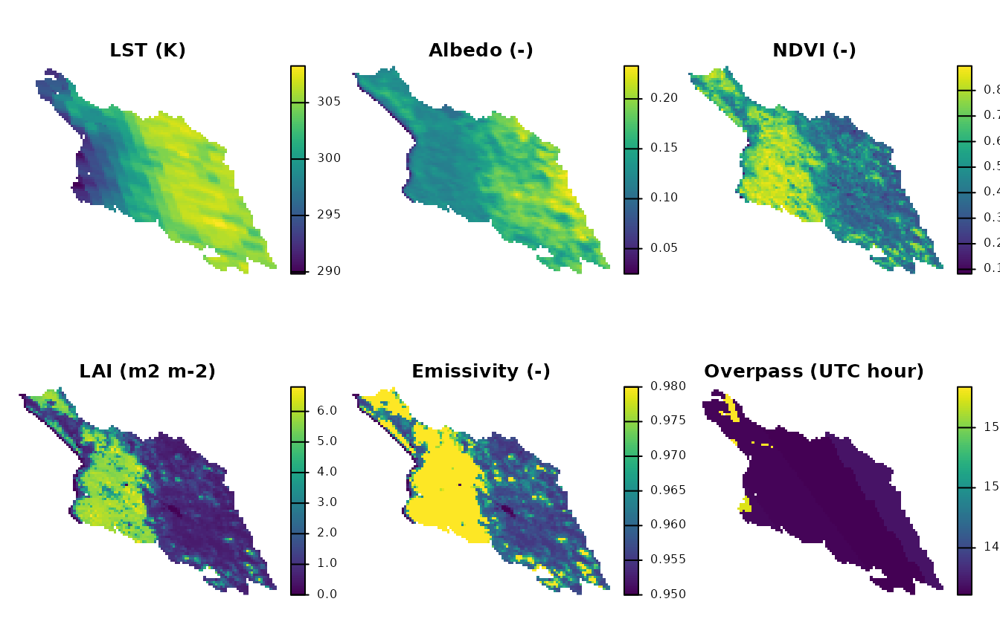
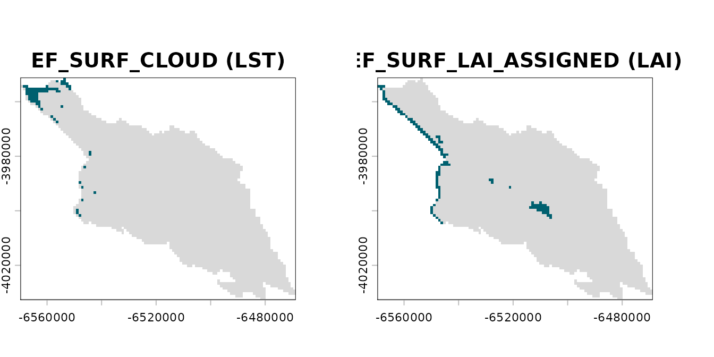
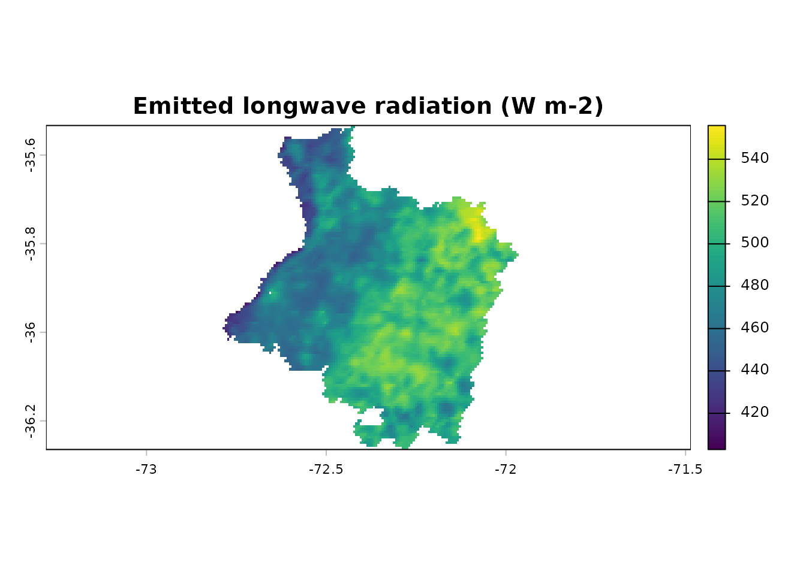

# Example scene: Cauquenes, 15 February 2019

EarthFlux ships one real MODIS scene, the dataset `cauquenes_modis`: the
surface state of the METRIC chain over the Cauquenes province (Maule
Region, Chile) for 15 February 2019 (UTC; Terra overpass), built from
the official MODIS collection 6.1 granules of tile h12v12 with the
package’s MODIS preprocessing. This article shows its layers, how to
read its flag words and where it comes from.

> **Experimental.** EarthFlux 0.1.0 is an experimental release. Most of
> the options used to build the scene (albedo, assigned LAI of the
> non-vegetated classes, aggregation) are candidates pending
> verification; the LAI-based emissivity follows the SEBAL Idaho manual
> (Waters et al., 2002). The scene is meant for examples, tests and
> documentation, not for scientific results.

Everything below runs offline from the installed package.

## The surface state

The dataset is a packed `terra` raster;
[`terra::unwrap()`](https://rspatial.github.io/terra/reference/wrap.html)
returns the `SpatRaster`.

``` r

library(EarthFlux)

r <- terra::unwrap(cauquenes_modis)
r
#> class       : SpatRaster
#> size        : 88, 109, 20  (nrow, ncol, nlyr)
#> resolution  : 926.6254, 926.6254  (x, y)
#> extent      : -6569774, -6468772, -4032674, -3951131  (xmin, xmax, ymin, ymax)
#> coord. ref. : +proj=sinu +lon_0=0 +x_0=0 +y_0=0 +R=6371007.181 +units=m +no_defs
#> source(s)   : memory
#> names       :    lst,  albedo,   ndvi, lai, emissivity, emis_31, ...
#> min values  : 289.82, 0.02475, 0.0821,   0,       0.95,   0.974, ...
#> max values  : 308.26,   0.233,  0.896, 6.8,       0.98,   0.984, ...
#> unit        :      K,       -,      -, m2 m-2,          -,       -, ...
```

Each layer carries its unit:

``` r

data.frame(layer = names(r), unit = terra::units(r))
#>                    layer   unit
#> 1                    lst      K
#> 2                 albedo      -
#> 3                   ndvi      -
#> 4                    lai m2 m-2
#> 5             emissivity      -
#> 6                emis_31      -
#> 7                emis_32      -
#> 8                    doy      -
#> 9               utc_hour      h
#> 10         ndvi_lag_days      d
#> 11 valid_fraction_albedo      -
#> 12    valid_fraction_lai      -
#> 13             flags_lst   bits
#> 14   flags_overpass_time   bits
#> 15          flags_albedo   bits
#> 16            flags_ndvi   bits
#> 17             flags_lai   bits
#> 18      flags_emissivity   bits
#> 19         flags_emis_31   bits
#> 20         flags_emis_32   bits
```

The grid is the native 1 km sinusoidal grid of the MOD11A1 file. Cells
outside the province are `NA` in every layer, flag words included.

Every computation in this article runs on that native grid. The maps are
projected to geographic coordinates (WGS 84, EPSG:4326) for display
only: continuous layers with bilinear interpolation and flag layers with
the nearest neighbour, so that no flag is interpolated.

``` r

to_lonlat <- function(x, method = "bilinear") {
  terra::project(x, "EPSG:4326", method = method)
}
```

``` r

vars <- c("lst", "albedo", "ndvi", "lai", "emissivity", "utc_hour")
terra::global(r[[vars]], c("min", "max", "mean"), na.rm = TRUE)
#>                  min       max        mean
#> lst        289.82000 308.26000 302.2553063
#> albedo       0.02475   0.23300   0.1531856
#> ndvi         0.08210   0.89600   0.5433044
#> lai          0.00000   6.80000   2.4266808
#> emissivity   0.95000   0.98000   0.9668765
#> utc_hour    14.10953  15.83827  14.1766055
```

## Maps

Land surface temperature (K, MOD11A1 `LST_Day_1km`), white-sky shortwave
albedo (MCD43A3), NDVI (MOD13A2 16-day composite), LAI (m2 m-2, MCD15A2H
8-day composite), broadband emissivity from LAI and the UTC hour of the
overpass of each cell (from `Day_view_time`, local solar time, and the
longitude of the cell).

``` r

terra::plot(
  to_lonlat(r[[vars]]),
  main = c("LST (K)", "Albedo (-)", "NDVI (-)", "LAI (m2 m-2)",
           "Emissivity (-)", "Overpass (UTC hour)"),
  nc = 3, axes = FALSE
)
```



## Flag words

Every variable has an integer flag word per cell (`flags_lst`,
`flags_albedo`, `flags_ndvi`, `flags_lai`, `flags_emissivity`,
`flags_overpass_time`, `flags_emis_31`, `flags_emis_32`). Bit `b` is set
when the flag of that bit applies to the layer in that cell; a value of
0 means that no flag applies. The bits of the surface stage are
documented in
[`?cauquenes_modis`](https://djwillichile.github.io/EarthFlux/reference/cauquenes_modis.md)
and listed as `flag_bits` in the provenance file of the scene
(`data-raw/cauquenes_modis.yml` of the source repository):

``` r

flag_bits <- data.frame(
  bit = 0:15,
  code = c(
    "EF_INPUT_NA", "EF_SURF_FILL", "EF_SURF_CLOUD", "EF_SURF_NOT_PRODUCED",
    "EF_SURF_DN_OUT_OF_RANGE", "EF_SURF_LAI_NONVEG", "EF_SURF_QA_OTHER",
    "EF_SURF_CLOUD_ADJACENT", "EF_SURF_SNOW", "EF_SURF_WATER",
    "EF_SURF_SALT_PAN", "EF_SURF_LAI_BACKUP", "EF_SURF_ALBEDO_MAGNITUDE",
    "EF_SURF_OVERPASS_MISSING", "EF_SURF_ALBEDO_GT1", "EF_SURF_LAI_ASSIGNED"
  ),
  severity = c(rep("info", 6), rep("warning", 8), "critical", "info")
)
flag_bits
#>    bit                     code severity
#> 1    0              EF_INPUT_NA     info
#> 2    1             EF_SURF_FILL     info
#> 3    2            EF_SURF_CLOUD     info
#> 4    3     EF_SURF_NOT_PRODUCED     info
#> 5    4  EF_SURF_DN_OUT_OF_RANGE     info
#> 6    5       EF_SURF_LAI_NONVEG     info
#> 7    6         EF_SURF_QA_OTHER  warning
#> 8    7   EF_SURF_CLOUD_ADJACENT  warning
#> 9    8             EF_SURF_SNOW  warning
#> 10   9            EF_SURF_WATER  warning
#> 11  10         EF_SURF_SALT_PAN  warning
#> 12  11       EF_SURF_LAI_BACKUP  warning
#> 13  12 EF_SURF_ALBEDO_MAGNITUDE  warning
#> 14  13 EF_SURF_OVERPASS_MISSING  warning
#> 15  14       EF_SURF_ALBEDO_GT1 critical
#> 16  15     EF_SURF_LAI_ASSIGNED     info
```

A bit is tested with `bitwAnd(value, 2^b) > 0`. The small helper below
returns a logical raster (`NA` outside the province) for one flag code:

``` r

has_flag <- function(words, code) {
  bit <- flag_bits$bit[flag_bits$code == code]
  terra::app(words, function(x) bitwAnd(x, 2^bit) > 0)
}
```

Cells of the province (cells with a flag word) and cells whose LST
quality control reports clouds (`EF_SURF_CLOUD`); in those cells the LST
is `NA`:

``` r

n_province <- terra::global(!is.na(r[["flags_lst"]]), "sum")$sum
cloud <- has_flag(r[["flags_lst"]], "EF_SURF_CLOUD")
n_cloud <- terra::global(cloud, "sum", na.rm = TRUE)$sum
c(province = n_province, cloud = n_cloud)
#> province    cloud 
#>     3779       72
```

Cells whose LAI was assigned by the option `lai_nonveg` (LAI 0 for the
non-vegetated MCD15A2H classes 249-254) instead of retrieved
(`EF_SURF_LAI_ASSIGNED`), wholly or in some of the 500 m sub-cells
aggregated to the cell. The flag is raised in the LAI layer and in the
emissivity layer derived from it, so the emissivity of those cells also
rests on an assigned value:

``` r

lai_assigned <- has_flag(r[["flags_lai"]], "EF_SURF_LAI_ASSIGNED")
emis_assigned <- has_flag(r[["flags_emissivity"]], "EF_SURF_LAI_ASSIGNED")
c(
  lai = terra::global(lai_assigned, "sum", na.rm = TRUE)$sum,
  emissivity = terra::global(emis_assigned, "sum", na.rm = TRUE)$sum
)
#>        lai emissivity 
#>        120        120
```

The same test applies to every code and layer. For example, the number
of cells of each layer where each flag applies:

``` r

word_layers <- grep("^flags_", names(r), value = TRUE)
counts <- sapply(word_layers, function(l) {
  w <- terra::values(r[[l]], mat = FALSE)
  vapply(flag_bits$bit, function(b) sum(bitwAnd(w, 2^b) > 0, na.rm = TRUE),
         numeric(1))
})
rownames(counts) <- flag_bits$code
counts[rowSums(counts) > 0, , drop = FALSE]
#>                          flags_lst flags_overpass_time flags_albedo flags_ndvi
#> EF_INPUT_NA                      0                   0            0          0
#> EF_SURF_FILL                   123                 123            0         34
#> EF_SURF_CLOUD                   72                   0            0          0
#> EF_SURF_NOT_PRODUCED            51                   0            0         34
#> EF_SURF_QA_OTHER               709                   0            0          0
#> EF_SURF_CLOUD_ADJACENT           0                   0            0         34
#> EF_SURF_SNOW                     0                   0            0         34
#> EF_SURF_WATER                    0                   0            0        271
#> EF_SURF_LAI_BACKUP               0                   0            0          0
#> EF_SURF_ALBEDO_MAGNITUDE         0                   0          110          0
#> EF_SURF_LAI_ASSIGNED             0                   0            0          0
#>                          flags_lai flags_emissivity flags_emis_31 flags_emis_32
#> EF_INPUT_NA                      0                1             0             0
#> EF_SURF_FILL                     1                0            70            70
#> EF_SURF_CLOUD                    0                0             0             0
#> EF_SURF_NOT_PRODUCED             1                0             0             0
#> EF_SURF_QA_OTHER               131                0             0             0
#> EF_SURF_CLOUD_ADJACENT           0                0             0             0
#> EF_SURF_SNOW                     0                0             0             0
#> EF_SURF_WATER                  476                0             0             0
#> EF_SURF_LAI_BACKUP              10                0             0             0
#> EF_SURF_ALBEDO_MAGNITUDE         0                0             0             0
#> EF_SURF_LAI_ASSIGNED           120              120             0             0
```

``` r

flagged <- c(cloud, lai_assigned)
names(flagged) <- c("EF_SURF_CLOUD (LST)", "EF_SURF_LAI_ASSIGNED (LAI)")
terra::plot(to_lonlat(flagged, method = "near"),
            col = c("grey85", "#00606F"), legend = FALSE, nc = 2)
```



## Emitted longwave radiation

The emitted longwave radiation is the one METRIC component that depends
on the surface state alone.
[`ef_rl_out()`](https://djwillichile.github.io/EarthFlux/reference/ef_rl_out.md)
works on numeric vectors, so the values of the layers are passed and the
result is written back into a raster with the same grid:

``` r

rl_out <- terra::rast(r[["lst"]])
terra::values(rl_out) <- ef_rl_out(
  lst = terra::values(r[["lst"]], mat = FALSE),
  emissivity = terra::values(r[["emissivity"]], mat = FALSE)
)
names(rl_out) <- "rl_out"
terra::global(rl_out, c("min", "max", "mean"), na.rm = TRUE)
#>             min      max     mean
#> rl_out 383.4013 489.6118 458.0683
terra::plot(to_lonlat(rl_out), main = "Emitted longwave radiation (W m-2)")
```



## Provenance

Official MODIS collection 6.1 granules of tile h12v12 from the NASA LP
DAAC cloud archive (LPCLOUD), found with NASA CMR and downloaded on 5
November 2026
([`?cauquenes_modis`](https://djwillichile.github.io/EarthFlux/reference/cauquenes_modis.md)):

| Role | Granule | Period | DOI |
|----|----|----|----|
| LST, band 31/32 emissivities, view time | `MOD11A1.A2019046.h12v12.061.2020344054048.hdf` | 2019-02-15 | [10.5067/MODIS/MOD11A1.061](https://doi.org/10.5067/MODIS/MOD11A1.061) |
| Albedo | `MCD43A3.A2019046.h12v12.061.2020290040302.hdf` | 2019-02-15 (window 2019-02-07 to 2019-02-22) | [10.5067/MODIS/MCD43A3.061](https://doi.org/10.5067/MODIS/MCD43A3.061) |
| NDVI | `MOD13A2.A2019033.h12v12.061.2020287215652.hdf` | 2019-02-02 to 2019-02-17 | [10.5067/MODIS/MOD13A2.061](https://doi.org/10.5067/MODIS/MOD13A2.061) |
| LAI | `MCD15A2H.A2019041.h12v12.061.2020288004458.hdf` | 2019-02-10 to 2019-02-17 | [10.5067/MODIS/MCD15A2H.061](https://doi.org/10.5067/MODIS/MCD15A2H.061) |

Options of the assembly (explicit; none is a package default): LST of
MOD11A1 (Terra); white-sky shortwave albedo of MCD43A3 of the same day;
NDVI of the MOD13A2 composite whose period contains the date, matched
per pixel with its composite day; LAI of the MCD15A2H composite whose
period contains the date; 500 m inputs aggregated with the mean, only
where every 500 m sub-cell is valid; broadband emissivity from LAI; LAI
0 assigned to the non-vegetated MCD15A2H classes 249-254; QA policy
`"flag"`.

The area of interest is the official boundary of the Cauquenes province
(DPA 2023, SUBDERE, published through IDE Chile), shipped in
`inst/extdata` with its provenance. The scene was built with the script
`data-raw/modis-example.R` of the source repository, whose full
provenance (CMR identifiers, options, verification status and software
versions) is in `data-raw/cauquenes_modis.yml`. MODIS data are shared
openly without restriction (EOSDIS Data Use and Citation Guidance).

## What is not in 0.1.0

The scene holds the surface state only. EarthFlux 0.1.0 does **not**
include, and this article does not show:

- **Meteorological forcing** for the scene: no weather station data or
  gridded weather forcing (air temperature, humidity, wind, solar
  radiation) are shipped, so the incoming radiation, the net radiation,
  the soil heat flux and the sensible heat calibration cannot be run on
  it yet.
- **Elevation model**: no DEM of the province (needed for pressure,
  slope, aspect and the datum of the surface temperature).
- **Map of actual evapotranspiration (ETa)**: there is no
  [`earthflux()`](https://djwillichile.github.io/EarthFlux/reference/earthflux.md)
  workflow and no ETa result for the scene.

These are the targets of milestone M5 (the
[`earthflux()`](https://djwillichile.github.io/EarthFlux/reference/earthflux.md)
workflow with automatic MODIS, elevation model and gridded weather
forcing, and presets). The comparison of forcing configurations against
independent observations (milestone M6) comes after it. Until then, no
ETa from EarthFlux should be interpreted as validated.
